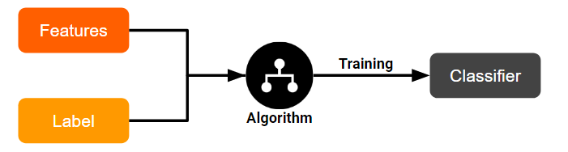

import CaptionedImage from '../../components/CaptionedImage.astro';

If you wanted to learn some basic machine learning, or you just wanted to find a fancy new way to write the **isEven()** function, you've come to the right place! In this article, I will show you how to leverage on "big data", "A.I." and "machine learning" to write your own **isEven()** function. (LOL)

<CaptionedImage
  src="iseven_with_ml/meme.png"
  alt="big brain meme"
  caption="Why solve the problem normally when you can solve them with AI?"
/>

## Introduction

In this article, you will learn how to code and build a simple machine learning pipeline using scikit-learn libraries in Python. For those that are familiar with machine learning, this article provides a fun (but dumb) way to write the famous **isEven()** function.

## Prerequisite

- Installed either [Anaconda](https://www.anaconda.com/distribution/) (recommended) or [Miniconda](https://docs.conda.io/en/latest/miniconda.html)
- Having basic Python or coding knowledge in general. (OPTIONAL)

## Problem Statement

We want to write a function, **isEven()** that can tell whether a given number is an even number, or an odd number. The function will return **True**, if an even number is provided, else, it will return **False**.

In this article, we will tackle this problem by utilizing the power of machine learning and data. We will build a machine learning model that **classifies a number as either even or odd**. This is known as a **classifier**, a machine learning model that performs **classification**.

<CaptionedImage
  src="iseven_with_ml/isEven_1.jpg"
  alt="training example"
  caption="Fancy methods to write isEven(). From <a href='https://www.facebook.com/PoorlyIndented/photos/a.133750464674568/213901103326170/'>Facebook</a>."
/>

# Disclaimer

While there are many ways to tackle this problem: some of them are creative, some of them are more efficient than the other. Essentially, there are many better ways to do this than what this article will teach you. In fact, in reality you wouldn't want to use machine learning to tackle a simple and well-defined problem like this. This tutorial will serve as your springboard to dive into solving more complex problems with machine learning in the future.

# Some concepts and terminologies

### Traditional Programming vs Machine Learning

Unlike traditional programming, instead of coding the program to classify it for us, we train an algorithm on the data and expected output, and the algorithm gives us the program.

<CaptionedImage
  src="iseven_with_ml/traditional_vs_ML.png"
  alt="traditional-vs-ml"
  caption="Traditional Programming vs Machine Learning."
/>

In the context of machine learning, these terms have this meaning:
- **Features**: The input data
- **Label**: The expected output
- **Model**: The program generated
- **Training**: Makes the model learn to predict the label from the features.



- **Inference**: Use a learned model to predict unseen data.


# Our Solution

We will build a classifier to classify whether a number is even or odd. In our case, our training and inference process would look like this:
- **Training**: We will use a `RandomForestClassifier` algorithm to train a new classifier, by feeding it with our features (integer), and their corresponding label (even or odd).

<CaptionedImage
  src="iseven_with_ml/example_training.png"
  alt="training example"
/>

- **Inference**: We will use the trained classifier to predict a number as either odd or even!

<CaptionedImage
  src="iseven_with_ml/example_inference.png"
  alt="inference example"
/>

## Coding time!

### 1. Launch Jupyter Notebook, see [here](https://jupyter.readthedocs.io/en/latest/install.html#installing-jupyter-using-anaconda-and-conda) to learn to install it.
### 2. Create a new Jupyter Notebook.
### 3. Create a new cell and paste the code below in a cell:

### 4. Import libraries

This code will import all the necessary libraries for the following tutorial. These libraries will be our tools that will aid us in our quest to building a machine learning model.

```python
import numpy as np
import pandas as pd
from sklearn.ensemble import RandomForestClassifier
from sklearn.model_selection import train_test_split
from sklearn.metrics import accuracy_score
from sklearn.pipeline import Pipeline
from sklearn.base import TransformerMixin
from sklearn.feature_selection import SelectFdr, chi2
from IPython import display
from sklearn.externals.six import StringIO
from IPython.display import Image
from sklearn.tree import export_graphviz
import pydotplus
import os
import warnings

# This is needed to display the graph
os.environ['PATH'] = os.environ['PATH']+';'+os.environ['CONDA_PREFIX']+r"\Library\bin\graphviz"

# Suppress all warnings
warnings.filterwarnings("ignore")
```

### 5. Getting the dataset

Before we can train a machine learning model, we need to prepare the data for training. In our case, we just have to generate the data, as we already know it. In reality, we need to collect the data ourselves, or get publicly available data.

We will generate our data and put it into a data frame like this:
- **Feature:** The integer
- **Label:** Even or Odd

```python
df = pd.DataFrame(
    data={
        # List of integers from 0 to 99 (100 integers)
        'number': range(100),
        # Alternating between Even and Odd for 50 times
        "label": ["Even", "Odd"] * 50
    }
)
df
```

The generated data frame looks like this:

<div>
<style scoped>
    .dataframe tbody tr th:only-of-type {'{'}
        vertical-align: middle;
    {'}'}
    .dataframe tbody tr th {'{'}
        vertical-align: top;
    {'}'}
    .dataframe thead th {'{'}
        text-align: right;
    {'}'}
</style>
<table border="1" className="dataframe">
  <thead>
    <tr style={{textAlign: 'right'}}>
      <th></th>
      <th>number</th>
      <th>label</th>
    </tr>
  </thead>
  <tbody>
    <tr><td>0</td><td>0</td><td>Even</td></tr>
    <tr><td>1</td><td>1</td><td>Odd</td></tr>
    <tr><td>2</td><td>2</td><td>Even</td></tr>
    <tr><td>3</td><td>3</td><td>Odd</td></tr>
    <tr><td>4</td><td>4</td><td>Even</td></tr>
    <tr><td>...</td><td>...</td><td>...</td></tr>
    <tr><td>95</td><td>95</td><td>Odd</td></tr>
    <tr><td>96</td><td>96</td><td>Even</td></tr>
    <tr><td>97</td><td>97</td><td>Odd</td></tr>
    <tr><td>98</td><td>98</td><td>Even</td></tr>
    <tr><td>99</td><td>99</td><td>Odd</td></tr>
  </tbody>
</table>
<p>100 rows × 2 columns</p>
</div>

We can inspect the first 5 rows using the `head()` function.

```python
df.head()
```

### 6. Getting X and y

In the context of machine learning, we usually denote:
- **X** : Features
- **y** : Label

```python
# Create X
X = df.drop(['label'], axis=1)
X.head()
```

```python
# Create y
y = df['label']
y.head()
```

```
0    Even
1     Odd
2    Even
3     Odd
4    Even
Name: label, dtype: object
```

### 7. Splitting the data

The next step is to split the data. While there are many more advanced methods of splitting data, we will focus on **train/test split** into a **training set** and **test set**.

We will take 70% of the data as the training set, and 30% as the test set.

> "Why do we need to split the data?"

We need to use the test set to test whether overfitting has taken place in our model.

> "What is overfitting?"

A model that overfits is unable to generalize well with new data. As an analogy, if a student memorizes all the answers for math problems instead of really understanding how math works, the student will perform badly on the test, where new math questions are given. Overfitting can be seen as the model trying to memorize the answer instead of learning to solve the question.

After splitting, we will have 4 groups of data:
- **X_train:** Features for training set
- **X_test:** Features for test set
- **y_train:** Label for training set
- **y_test:** Label for test set

Some of you might notice that we had set `random_state=77`. This is to ensure the split is always consistent in this tutorial; in reality, you will not want to set the random state.

```python
X_train, X_test, y_train, y_test = train_test_split(X, y, test_size=0.30, random_state=77)
# Fix random state to get consistent result
```

### 8. Training Attempt #1 - RandomForestClassifier

After splitting the data we are now ready to train a model. We will first attempt to train a `RandomForestClassifier`. A random forest is basically made up of multiple decision trees. More on that later.

We will create a random forest with 3 trees by setting `n_estimators=3`. After initializing our model, we can now train the model by calling `fit()`.

```python
# Initialize the classifier
classifier = RandomForestClassifier(n_estimators=3, random_state=7)

# Fit the model with our train set (training the model)
classifier.fit(X_train, y_train)
```

After training, we will check the performance of our model by inferencing/predicting on the test set we prepared earlier.

```python
# Predict on our test set
y_pred = classifier.predict(X_test)

# Visualize some of the prediction
pd.DataFrame(
    data={
        "number": X_test['number'],
        "predicted_label": y_pred,
        "true_label": y_test
    }
).head()
```

As we can see, the classifier managed to get most of the predictions wrong. Let's quantify the performance of our classifier by checking the accuracy.

```python
accuracy_score(y_test, y_pred)
```

```
0.23333333333333334
```

Our classifier managed to score an accuracy of only 23%! This is worse than randomly guessing, which will result in 50% accuracy on average!

### 9. Training Attempt #2 - RandomForestClassifier + Feature Engineering

> "What is feature engineering?"

Feature engineering is one of the most important steps when building a machine learning model. In fact, it is often cited as the most time-consuming part of training a model. Feature engineering refers to the process of modifying or transforming the data, with the goal of improving a machine learning model.

There are many methods to perform feature engineering, and these methods are often used in conjunction with each other to maximize the improvements. Some of the feature engineering processes include filling in missing data, removing outliers, etc. Machine learning engineers often rely on domain knowledge or experience to tackle feature engineering, instead of trying different methods by trial and error.

In our case, knowing some basic binary maths, we know that all decimal integers can be represented as binary numbers. By converting a decimal integer into a binary number, we can get more features!

As an illustration:

```
 0 => 0000000
 8 => 0000111
99 => 1100011
```

For decimal numbers from 0 to 99, we are able to represent them with 7 digits in the binary system, by keeping the leading zeroes. Each of these 7 digits can be seen as a new feature! I have written a [scikit-learn transformer](https://scikit-learn.org/stable/modules/generated/sklearn.base.TransformerMixin.html), the `BinaryEncoder`, to transform our data automatically from decimals to a 7-digit binary number, and then into a 7-column dataframe.

```python
class BinaryEncoder(TransformerMixin):
    def __init__(self, n=8):
        # Minimum number of digits to use
        self.n = n

    def fit(self, X, y=None):
        max_len = self.n
        if isinstance(X, pd.DataFrame):
            X = X.values
        for row in X:
            # Convert decimal to binary, and pad to n digits
            binary = format(row[0], '0'+str(self.n)+'b')
            # Check if length of binary is greater than max_len
            if len(binary) > max_len:
                max_len = len(binary)
        if self.n < max_len:
            self.n = max_len
        return self

    def transform(self, X):
        # New rows
        new_rows = []
        if isinstance(X, pd.DataFrame):
            X = X.values
        # Iterate row
        for row in X:
            # Convert decimal to binary, and pad to n digits
            binary = format(row[0], '0'+str(self.n)+'b')
            # Add to new_rows
            new_rows.append([int(digit) for digit in binary])
        # Return as numpy.ndarray
        return np.array(new_rows)
```

As an example, we can do this:

```python
be = BinaryEncoder(n=7)
bin = be.fit_transform([[0], [8], [99]])
bin
```

```
array([[0, 0, 0, 0, 0, 0, 0],
       [0, 0, 0, 1, 0, 0, 0],
       [1, 1, 0, 0, 0, 1, 1]])
```

We can now chain the `BinaryEncoder` with our `RandomForestClassifier` inside a [pipeline](https://scikit-learn.org/stable/modules/generated/sklearn.pipeline.Pipeline.html) to make the training process smoother. The pipeline will automatically pass the data through each pipeline component (transformer) and finally train the model at the end of the pipeline. Pipeline allows us to skip having to manually call `fit_transform()` for all the transformers in the pipeline.

```python
# Create a pipeline that chains BinaryEncoder and RandomForestClassifier
pipe = Pipeline(
    steps=[
        ('binary_encoder', BinaryEncoder(n=7)), # fit_transform() will be called automatically
        ('classifier', RandomForestClassifier(n_estimators=3, random_state=7)) # Model must be at the end of the pipe
    ]
)
```

Our pipeline now looks like this:

<CaptionedImage
  src="iseven_with_ml/pipeline_01.png"
  alt="machine learning pipeline with feature engineering"
/>

```python
# Fits the data through pipeline
pipe.fit(X_train, y_train)
```

Let's check the model's performance after we perform feature engineering.

```python
# Predict on our test set
y_pred = pipe.predict(X_test)
accuracy_score(y_test, y_pred)
```

```
0.9
```

We managed to boost our accuracy to 90%! While getting an accuracy of 90% can be quite good for most cases in a real-world scenario, we know as a fact that any good programmer can come up with a function that can classify an integer as even or odd 100% of the time. How can we make the model learn to do this?

Before we dive into the solution, let's learn more about how `RandomForestClassifier` works. Without going into too much detail, a random forest is basically made up of multiple decision trees; each **decision tree** will make a prediction and vote on the final prediction.

A **decision tree** is made up of multiple nodes, each containing a condition for some feature. The input is passed into the root node, and slowly branches out until reaching the leaf nodes, where the final prediction is made.

The below code visualizes the decision trees in our `RandomForestClassifier`.

```python
dot_data = StringIO()

i_tree = 0
for tree_in_forest in pipe.get_params()['classifier'].estimators_:
    dot_data = StringIO()
    export_graphviz(tree_in_forest, out_file=dot_data,
                    filled=True, rounded=True,
                    special_characters=True,
                   )
    graph = pydotplus.graph_from_dot_data(dot_data.getvalue())
    display.display(Image(graph.create_png()))
```

<CaptionedImage
  src="iseven_with_ml/output/output_37_0.png"
  alt="tree 1"
/>

<CaptionedImage
  src="iseven_with_ml/output/output_37_1.png"
  alt="tree 2"
/>

<CaptionedImage
  src="iseven_with_ml/output/output_37_2.png"
  alt="tree 3"
/>

As you can see from the trees plotted above, they're unnecessarily complex and some irrelevant features are used.

Why? In our case, only the feature X<sub>6</sub> (right most binary digit) is useful in classifying the numbers. In fact, all even numbers have X<sub>6</sub>=0, while all odd numbers have X<sub>6</sub>=1.

In our case, the classifier had managed to identify X<sub>6</sub> as an important feature, but due to the noise from other features, it was unable to predict correctly all the time. This can be seen by showing the feature importance of each feature using `feature_importances_`. Notice how the last feature (X<sub>6</sub>) has almost 80% importance, the highest among all the features.

```python
feature_names = ["X"+str(i) for i in range(7)]
feature_importance = pipe.get_params()['classifier'].feature_importances_.tolist()

pd.DataFrame(
    data={
        "feature_names": feature_names,
        "feature_importance": feature_importance
    }
)
```

| | feature_names | feature_importance |
|---|---|---|
| 0 | X0 | 0.038308 |
| 1 | X1 | 0.028966 |
| 2 | X2 | 0.038909 |
| 3 | X3 | 0.053511 |
| 4 | X4 | 0.017090 |
| 5 | X5 | 0.023229 |
| 6 | X6 | 0.799986 |

In reality, we won't know which feature is the most important, and which features are just noise. If only there were ways to automatically deal with it.

### 10. Training Attempt #3 - Adding Feature Selection

> "What is feature selection?"

**Feature selection** is the process of selecting a subset of features manually or automatically to train a model.

The goal of feature selection is usually to:
- Improve the model's ability to generalize by removing irrelevant features
- Reduce training time

We wanted to select the features automatically, and while there are many feature selection methods that can do just that, we will be using one of the methods.

We will use a univariate feature selection method that will perform some statistical test on each feature relative to the label, and give a p-value. If the p-value is below the alpha, the feature won't be selected.

We will use one of the univariate feature selection transformers provided by sklearn, `SelectFdr()`, where features with a low false discovery rate are kept. We will calculate the statistics with `chi2`, as it is suitable for classification problems with non-negative features.

```python
# Binarize
be = BinaryEncoder(n=7)
bin_X = be.fit_transform(X_train, y_train)

# Feature selection
fs = SelectFdr(chi2, alpha=0.05)
fs.fit(bin_X, y_train)

# Show p-values
make_float = lambda x: str("{:,.9f}".format(x))
temp = pd.DataFrame(
    data={
        "feature_names": feature_names,
        "p_values": fs.pvalues_.tolist(),
        "selected?": [(p < 0.05) for p in fs.pvalues_.tolist()],
    }
)
temp["p_values"] = temp["p_values"].apply(make_float) # Make it show digits

temp
```

| | feature_names | p_values | selected? |
|---|---|---|---|
| 0 | X0 | 0.841480581 | False |
| 1 | X1 | 0.834827329 | False |
| 2 | X2 | 0.857462442 | False |
| 3 | X3 | 0.861804433 | False |
| 4 | X4 | 0.621873424 | False |
| 5 | X5 | 0.865772375 | False |
| 6 | X6 | 0.000000003 | True |

As we can see from the code above, our feature selection method is able to select X<sub>6</sub> as the only important feature! Let's now put the feature selection method into our machine learning pipeline and retrain our model!

```python
pipe = Pipeline(
    steps=[
        ('binary_encoder', BinaryEncoder(n=8)),
        ('feature_selector', SelectFdr(chi2, alpha=0.01)),
        ('classifier', RandomForestClassifier(n_estimators=3, random_state=7))
    ]
)
```

Our updated pipeline:

<CaptionedImage
  src="iseven_with_ml/pipeline_02.png"
  alt="machine learning pipeline with feature engineering and feature selection"
/>

```python
pipe.fit(X_train, y_train)
y_pred = pipe.predict(X_test)
accuracy_score(y_test, y_pred)
```

```
1.0
```

Look! We managed to boost our accuracy to **100%**! The feature selection correctly identified X<sub>6</sub> as the only relevant feature, discarding all noise.

```python
pipe.get_params()['classifier'].feature_importances_.tolist()
```

```
[1.0]
```

Let's visualize the trees in our model.

```python
i_tree = 0
for tree_in_forest in pipe.get_params()['classifier'].estimators_:
    dot_data = StringIO()
    export_graphviz(tree_in_forest, out_file=dot_data,
                    filled=True, rounded=True,
                    special_characters=True)
    graph = pydotplus.graph_from_dot_data(dot_data.getvalue())
    display.display(Image(graph.create_png()))
```

<CaptionedImage
  src="iseven_with_ml/output/output_52_0.png"
  alt="decision tree visualization"
/>

<CaptionedImage
  src="iseven_with_ml/output/output_52_1.png"
  alt="decision tree visualization 2"
/>

<CaptionedImage
  src="iseven_with_ml/output/output_52_2.png"
  alt="decision tree visualization 3"
/>

All of the trees now only consider one feature and the irrelevant features are ignored!

Note that X<sub>0</sub> was previously X<sub>6</sub>, but now it is the only feature, thus being index 0.

### 11. Serializing our model

Model training is a time-consuming process in real life and we can't afford to train it every time. Instead, we will serialize it and save it to a file, and load it back whenever we need to use it.

We will be using the `pickle` module for this task.

```python
import pickle

with open('classifier.pkl', 'wb') as f:
    pickle.dump(pipe, f)
```

### 12. Writing the `isEven()` function, using our model

Finally, we can now use our model to write the `isEven()` function!

```python
def isEven(x):
    # First, load the model
    with open('classifier.pkl', 'rb') as f:
        pipe = pickle.load(f)
    return pipe.predict(np.array([[x]]))[0] == 'Even' # Return True if prediction is `Even`
```

Let's try our function on some unseen numbers!

```python
for i in [103, 104, 180, 193]:
    print("isEven({}) = {}".format(i, isEven(i)))
    print()
```

```
isEven(103) = False

isEven(104) = True

isEven(180) = True

isEven(193) = False
```

Note: Numbers that have more than 7 digits in their binary form can't work with our classifier!

```python
print("isEven({}) = {}".format(350, isEven(350)))
```

```
c:\...\lib\site-packages\sklearn\feature_selection\base.py in transform(self, X)
     80             return np.empty(0).reshape((X.shape[0], 0))
     81         if len(mask) != X.shape[1]:
---> 82             raise ValueError("X has a different shape than during fitting.")
     83         return X[:, safe_mask(X, mask)]


ValueError: X has a different shape than during fitting.
```

Well, at least a normal human being can fix that in 2 lines:

```python
# This is how a normal human being would write the `isEven()` function
def isEven(x):
    return x % 2 == 0

for i in [103, 104, 180, 193]:
    print("isEven({}) = {}".format(i, isEven(i)))
    print()
```

```
isEven(103) = False

isEven(104) = True

isEven(180) = True

isEven(193) = False
```

## Conclusion

Congratulations! You have now (foolishly) solved the simple problem of classifying a number as even or odd, by applying machine learning!

> "What a waste of time! I could've coded it in 2 lines, like this:
> ```python
> # This is how a normal human being would write the `isEven()` function
> def isEven(x):
>     return x % 2 == 0
> ```
> "

Well, no. Throughout the tutorial, you have learned:
- how machine learning differs from traditional programming
- how to build and evaluate a machine learning model
- how to build a machine learning pipeline
- the concepts of feature engineering and feature selection

> "But, I already know all these stuffs!"

Well, at least now you can brag to your friends how you managed to **force an AI to write simple functions** for you. XD

The code and Jupyter notebook for this tutorial can be found [here](https://github.com/xKHUNx/ml-iseven).

I hope you learned a thing or two from this tutorial, or at least enjoyed it. Stay tuned for more content on programming!
